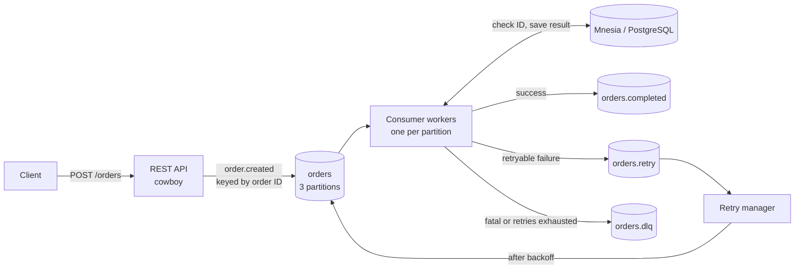

# Order Processing System

A fault-tolerant, event-driven order processing backend built with **Erlang/OTP** and **Apache Kafka**.

Orders arrive over a REST API, are published to Kafka, and are processed by supervised consumer workers with retries, a dead-letter topic, and idempotency. The goal: **no order is ever lost or charged twice, even when workers crash mid-flight.**

There is no frontend. You drive it with `curl`, Postman, or a producer script.

> **Status:** in progress. Phases 1–4 of 9 are done: orders flow end to end from `POST /orders` through Kafka to a stored `completed` status, and a killed consumer recovers without losing orders. Retries and duplicate protection come in phases 5–6. Until then, a gateway timeout goes straight to `orders.dlq`, and the simulated gateway's failure rates are set to 0. See [Roadmap](#roadmap).

---

## Contents

- [How it works](#how-it-works)
- [Tech stack](#tech-stack)
- [Prerequisites](#prerequisites)
- [Quick start](#quick-start)
- [Using the API](#using-the-api)
- [Running the tests](#running-the-tests)
- [Project layout](#project-layout)
- [Design principles](#design-principles)
- [Roadmap](#roadmap)
- [Troubleshooting](#troubleshooting)

---

## How it works



1. `POST /orders` validates the body and publishes an `order.created` event to the `orders` topic, keyed by order ID so one order always lands on the same partition.
2. A consumer worker reads the event and checks the idempotency store. An order it has already seen is skipped.
3. The worker validates the order and calls a simulated payment gateway.
4. **Success:** the result is saved, the ID is marked as processed, and the event goes to `orders.completed`.
5. **Retryable failure** (such as a gateway timeout): the event goes to `orders.retry` with backoff of 1 s, then 5 s, then 30 s.
6. **Fatal failure** (validation error or declined payment) or retries used up: the event goes to `orders.dlq`.
7. `GET /orders/:id` returns the order's current status at any time.

### Delivery guarantees

- **At-least-once delivery** from Kafka, with **manual offset commits** only after an order is saved, retried, or dead-lettered.
- **Idempotent processing** on top, so a redelivered message does not create a duplicate. The result is effectively exactly once, without Kafka transactions.
- **One worker process per partition**, so partitions are processed in parallel. If a worker crashes, the consumer group restarts under its supervisor and every partition resumes from its last committed offset. No order is lost, at the cost of a pause of a few seconds.
- **No worker ever sleeps on a failed order.** It hands the order to the retry topic and moves on, so one bad order cannot block a partition.

### Kafka topics

| Topic | Written by | Read by | Purpose |
| --- | --- | --- | --- |
| `orders` | REST API, retry manager | Consumer workers | New orders and orders whose backoff has expired |
| `orders.retry` | Consumer workers | Retry manager | Failed orders waiting for backoff |
| `orders.completed` | Consumer workers | Downstream services | Successful orders |
| `orders.dlq` | Consumer workers | Operators | Orders that failed fatally or used up their retries |

### Order event

Every topic carries this JSON shape:

```json
{
  "id": "o-1001",
  "customer_id": "c-42",
  "amount": 1500,
  "currency": "INR",
  "items": [{"sku": "SKU-1", "qty": 2}],
  "attempt": 0,
  "created_at": "2026-11-14T10:00:00Z"
}
```

`amount` is an integer in the smallest currency unit (paise, cents), **never a float**. The server sets `attempt` and `created_at`.

---

## Tech stack

| Area | Choice |
| --- | --- |
| Language and build | Erlang/OTP 28, `rebar3` |
| Kafka client | [`brod`](https://github.com/kafka4beam/brod) |
| HTTP | `cowboy` |
| JSON | `jsx` |
| Fast state | Mnesia (order records until phase 8, then idempotency keys and retry counters) |
| System of record | PostgreSQL through `epgsql` (phase 8) |
| Metrics | `prometheus.erl` (phase 9) |
| Tests | EUnit, PropEr, Common Test, `meck`, Pact |
| Infrastructure | Docker Compose: Kafka 3.9 (KRaft, no ZooKeeper), PostgreSQL 16 |

---

## Prerequisites

You need only:

- **Docker** with Docker Compose v2 (Docker Desktop on Windows and macOS)
- **Git**, plus a POSIX shell for the helper scripts (Git Bash works on Windows)
- **`curl`** to try the API

You do **not** need Erlang or `rebar3` on your machine. All Erlang code builds and runs inside a Linux container, because `brod`'s CRC32C native extension (`crc32cer`) does not build on Windows. Your checkout is mounted into the container, so you edit files locally as usual.

---

## Quick start

```bash
# 1. Clone
git clone https://github.com/ShivamGupta322/order-processing
cd order-processing

# 2. Start Kafka and PostgreSQL
docker compose up -d

# 3. Create the four topics, once Kafka reports healthy (about 30 s)
docker compose ps                 # wait for kafka: "(healthy)"
./scripts/create_topics.sh        # on Windows, run from Git Bash

# 4. Build the dev image and start the app (interactive Erlang shell on :8080)
docker compose run --rm --service-ports app rebar3 shell --sname order_processing
```

The `--sname` matters: Mnesia stores orders on disk under the node name (`order_processing@app`), so the name must stay the same between runs.

The first run downloads and compiles dependencies, which takes a few minutes. Later runs are fast, because build output and the package cache live in Docker volumes.

To run the app in the background instead:

```bash
docker compose --profile dev up -d app
docker compose logs -f app        # follow the logs
docker compose stop app           # stop it
```

Check that it is up:

```bash
curl localhost:8080/health
# {"status":"ok"}
```

### Stopping everything

```bash
docker compose --profile dev down
```

> Kafka has no data volume, so topics are lost when its container is removed or recreated. Run `./scripts/create_topics.sh` again after `down`. The script is safe to re-run.
>
> Stored orders live in the `mnesia_data` volume and survive `down`. To wipe them, run `docker compose --profile dev down -v`. That also deletes the build cache volumes, so the next start recompiles.

---

## Using the API

| Method and path | Purpose | Responses |
| --- | --- | --- |
| `POST /orders` | Validate and publish an order | `202` with order ID; `400` invalid body; `413` body too large; `503` Kafka unavailable |
| `GET /orders/:id` | Current order status | `200` with order; `404` unknown or not yet processed |
| `GET /metrics` | Prometheus scrape endpoint | `200` *(phase 9)* |
| `GET /health` | Liveness check | `200` |

`POST /orders` returns **`202 Accepted`**, not `201 Created`, because processing happens asynchronously after the event is published.

### Place an order

```bash
curl -X POST localhost:8080/orders \
  -H 'content-type: application/json' \
  -d '{"id":"o-1001","customer_id":"c-42","amount":1500,"currency":"INR","items":[{"sku":"SKU-1","qty":2}]}'
# 202 {"id":"o-1001"}
```

### Check its status

The order is processed asynchronously, usually within a second or two:

```bash
curl localhost:8080/orders/o-1001
# 200 {"id":"o-1001","status":"completed","customer_id":"c-42","amount":1500,"currency":"INR",
#      "items":[{"sku":"SKU-1","qty":2}],"attempt":0,"created_at":"...","updated_at":1794685666388}
```

`status` is `completed` or `failed` (payment declined). `updated_at` is Unix time in milliseconds. An order that has not been consumed yet returns `404`.

### Validation rules

| Field | Rule |
| --- | --- |
| `id`, `customer_id` | Non-empty string |
| `amount` | Positive integer (floats are rejected) |
| `currency` | One of `INR`, `USD`, `EUR`, `GBP` |
| `items` | Non-empty list of `{"sku": non-empty string, "qty": positive integer}` |

Unknown fields are ignored. Errors name the first failing field:

```bash
curl -X POST localhost:8080/orders -H 'content-type: application/json' \
  -d '{"id":"o-1002","customer_id":"c-42","amount":-5,"currency":"INR","items":[{"sku":"SKU-1","qty":2}]}'
# 400 {"error":"invalid","field":"amount"}
```

### Watch messages arrive in Kafka

```bash
# MSYS_NO_PATHCONV=1 stops Git Bash on Windows from rewriting /opt/... into a Windows path
MSYS_NO_PATHCONV=1 docker compose exec kafka /opt/kafka/bin/kafka-console-consumer.sh \
  --bootstrap-server localhost:9092 --topic orders.completed --from-beginning \
  --property print.key=true --property print.partition=true
```

Swap the topic for `orders` or `orders.dlq` to see those. To see the consumer group's committed offsets and lag:

```bash
MSYS_NO_PATHCONV=1 docker compose exec kafka /opt/kafka/bin/kafka-consumer-groups.sh \
  --bootstrap-server localhost:9092 --describe --group order_consumers
```

### Crash a worker

Attach to the running app (`docker attach ordermanagement-app-1`, detach with `Ctrl-P Ctrl-Q`), or start it with `docker compose run --rm --service-ports app rebar3 shell --sname order_processing`. Then, in the Erlang shell:

```erlang
{ok, Workers} = consumer_worker:partition_workers().   % #{0 => Pid0, 1 => Pid1, 2 => Pid2}
exit(maps:get(0, Workers), kill).
```

The consumer group restarts within a few seconds (`consumer_worker_started` in the logs), and orders posted before, during, and after the kill all reach `completed`. `e2e_SUITE` automates this with 30 orders.

### Try a failure

Set `{gateway_decline_rate, 1.0}` in `config/sys.config` and restart the app. Every order is then declined: `GET` shows `"status":"failed"`, and the order appears on `orders.dlq` with `"reason":"declined"`. A message that is not valid JSON goes to `orders.dlq` too, base64-encoded, so a bad message never blocks its partition.

---

## Running the tests

Run every command inside the app container, with Kafka and PostgreSQL up (`docker compose up -d`):

```bash
docker compose run --rm app rebar3 compile
docker compose run --rm app rebar3 eunit --cover
docker compose run --rm app rebar3 ct --dir test/ct --suite order_consumer_SUITE,order_producer_SUITE --cover
docker compose run --rm app rebar3 cover --verbose     # coverage summary
docker compose run --rm app rebar3 dialyzer

# End-to-end against real Kafka (not in the default run; skips itself if Kafka is down)
docker compose run --rm app rebar3 ct --dir test/ct --suite e2e_SUITE
```

The unit and Common Test suites do **not** need Kafka. The Kafka client, the consumer group, and the payment gateway are mocked at their edges, and Mnesia runs in RAM, so the suites run fast, give the same result every time, and leave no files behind.

| Layer | Tool | Covers | Location |
| --- | --- | --- | --- |
| Unit | EUnit, PropEr | Validation, JSON codec (with a property-based round trip), processor outcomes, Mnesia store, simulated gateway | `test/unit/` |
| Integration | Common Test, `meck` | HTTP API, consumer outcomes (completed, declined, timeout, invalid, poison message), `GET /orders/:id`, consumer restart after a crash; later retries, duplicates | `test/ct/` |
| Contract | Pact message pact | Shape of the `order.created` event between producer and consumer | `test/pact/` *(phase 7)* |
| End-to-end | Common Test | Real Kafka: an order completes; 30 orders all complete despite a worker killed mid-batch; later DLQ | `test/ct/e2e_SUITE.erl` |

**Current results:**
- EUnit: 65 tests pass, including 300 generated PropEr round-trip cases.
- Common Test: all 14 mocked cases pass (consumer suite 8, producer suite 6).
- End-to-end: both cases pass against real Kafka.
- Dialyzer: clean.
- Line coverage: 88%. `order_producer` shows 0% because tests replace it with a mock; a live run against Kafka exercises it.

---

## Project layout

```
.
├── config/
│   ├── sys.config            app settings: ports, Kafka endpoints, timeouts
│   └── vm.args
├── docs/
│   └── IMPLEMENTATION_GUIDE.md   architecture, data shapes, semantics, milestones
├── include/
│   ├── order_topics.hrl      Kafka topic names, defined once
│   └── order_tables.hrl      Mnesia records and table names, defined once
├── scripts/
│   └── create_topics.sh      creates the four topics (safe to re-run)
├── src/
│   ├── order_app.erl         application entry point
│   ├── order_sup.erl         top-level supervisor
│   ├── order_http_handler.erl   thin HTTP shell: POST /orders, GET /orders/:id, /health
│   ├── order_validator.erl   pure: field and amount checks
│   ├── order_codec.erl       pure: JSON encode and decode, DLQ messages
│   ├── order_producer.erl    the only module that publishes to Kafka
│   ├── consumer_sup.erl      supervises the brod consumer group
│   ├── consumer_worker.erl   thin Kafka shell: decode, process, publish outcome, commit
│   ├── order_processor.erl   business flow, returns retryable or fatal errors
│   ├── payment_gateway.erl   simulated gateway with configurable failure rates
│   ├── order_store.erl       storage behaviour, implementation chosen in config
│   ├── order_store_mnesia.erl   Mnesia implementation
│   ├── order_mnesia.erl      creates the schema and tables at boot
│   └── order_clock.erl       the one place the app reads the clock
├── test/
│   ├── unit/                 EUnit and PropEr
│   └── ct/                   Common Test suites
├── docker-compose.yml        Kafka, PostgreSQL, and the dev app container
├── Dockerfile.dev            Erlang 28 plus cmake (for brod's native extension)
└── rebar.config
```

### Supervision tree (target)

```
order_app
└── order_sup (one_for_one)
    ├── producer_sup        brod client                   ✅
    ├── consumer_sup        supervisor                    ✅
    │     └── consumer_group    brod group subscriber, one worker per partition
    ├── http_sup            cowboy listener               ✅
    ├── retry_manager       delayed retries               (phase 5)
    ├── idempotency_store   Mnesia-backed                 (phase 6)
    └── metrics_server                                    (phase 9)
```

Children start in the order shown and stop in reverse. On shutdown, HTTP stops first, then the consumers, then the producer they both depend on. Each partition worker finishes the order it is handling before it stops, and acked offsets are committed on the way out.

---

## Design principles

- **Pure core, thin shells.** Validation, encoding, and the retry policy are pure functions: data in, data out, with no processes, I/O, or clock reads. The HTTP handler and the consumer worker only translate between the outside world and that core.
- **One way to reach Kafka and one way to reach storage.** Only `order_producer` and `consumer_worker` call `brod`. All storage goes through the `order_store` behaviour, so Mnesia and PostgreSQL can be swapped through config.
- **Let it crash, on purpose.** No defensive `try/catch`. Failures are handled by supervisors, and only errors with a meaningful response are caught (for example, a Kafka error becomes `503`).
- **Errors are classified.** The processor returns `{error, retryable, _}` or `{error, fatal, _}`, so the caller chooses retry or DLQ without inspecting the reason.
- **No atoms from external input.** Only a fixed set of known JSON keys is converted to atoms, because atoms are never garbage collected.

For the full specification, see [`docs/IMPLEMENTATION_GUIDE.md`](docs/IMPLEMENTATION_GUIDE.md).

---

## Roadmap

| Phase | Build | Done when | Status |
| --- | --- | --- | --- |
| 1. Setup | `rebar3` app, Docker Compose, topics script | Kafka runs and the app boots | ✅ |
| 2. API and producer | cowboy handler, validator, codec, producer | `curl POST /orders` puts a message on `orders` | ✅ |
| 3. Basic consumer | `consumer_worker`, `order_processor`, Mnesia store | An order is consumed and `GET /orders/:id` shows `completed` | ✅ |
| 4. Supervision | `consumer_sup`, one worker per partition, manual commits | Killing a worker restarts it and no order is lost | ✅ |
| 5. Retry and DLQ | `retry_policy`, `retry_manager`, error classification | A failing order retries three times, then lands on `orders.dlq` | ⏳ next |
| 6. Idempotency | `idempotency_store`, gateway idempotency key | The same order sent twice is charged once | |
| 7. Contract tests | Pact file and suites | Renaming a field on the producer fails the build | |
| 8. PostgreSQL | `order_store_pg` behind the behaviour | Switching `store_impl` changes the store with no code change | |
| 9. Metrics and release | Prometheus, JSON logs, `relx` release, CI | `docker compose up` starts everything and CI is green | |

---

## Troubleshooting

**`curl` returns `503 {"error":"kafka_unavailable"}`.**
The app cannot reach Kafka, or the topics do not exist. Check `docker compose ps` and run `./scripts/create_topics.sh`.

**The app container exits right after starting.**
The `brod` client exits at startup if no broker is reachable. Make sure Kafka shows `(healthy)` in `docker compose ps`. The `app` service waits for that health check, but a Kafka restart afterwards can still cause it.

**`create_topics.sh` fails with `no such file or directory: C:/Program Files/Git/opt/kafka/...`.**
Git Bash is rewriting the container path. The script sets `MSYS_NO_PATHCONV=1` itself; set it yourself when you run `docker compose exec` by hand.

**`GET /orders/:id` returns `404` right after a `202`.**
Processing is asynchronous, so wait a second and retry. If it stays `404`, check `docker compose logs app` for `order_dead_lettered`: an order that fails validation or times out is not stored, and goes to `orders.dlq` instead.

**The app fails at boot with a Mnesia error after you changed the node name.**
Disc tables belong to the node that created them. Start the shell with `--sname order_processing`, or wipe the data with `docker compose --profile dev down -v`.

**A port is already in use (8080, 9092, or 5432).**
Stop whatever holds the port, or change the host side of the port mapping in `docker-compose.yml`.

**Running `rebar3` directly on Windows (outside Docker).**
This is not supported. `brod`'s native extension will not build. If you have OTP 28 and `rebar3` installed anyway, set `TMPDIR` to a Windows path first: OTP 28 reports its architecture as `x86_64-pc-windows`, so `rebar3` takes its Unix temp-directory branch and builds a broken `\tmp` path.
